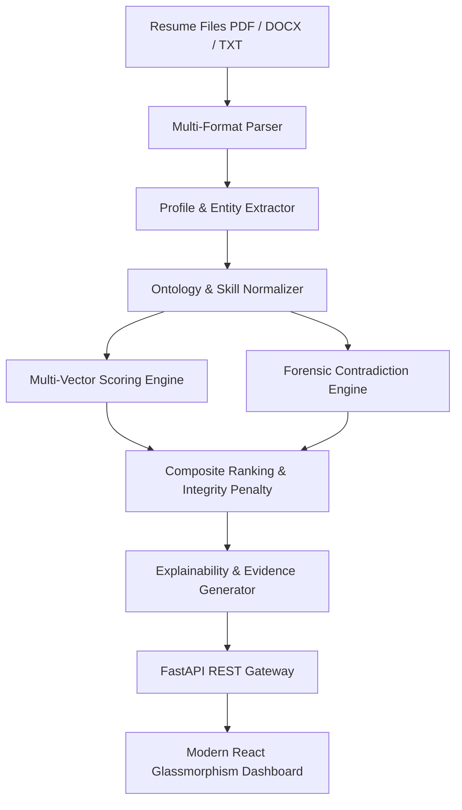

# NexusMatch AI — AI Resume & Job Matching System
### Algothon '26 | Problem ID: ALG-AI-01

[](https://fastapi.tiangolo.com)
[](https://react.dev)
[](https://vitejs.dev)
[](https://scikit-learn.org)
[](https://python.org)
[](LICENSE)

**NexusMatch AI** is a production-ready, explainable AI Applicant Tracking System (ATS) that moves beyond simplistic keyword matching. It features **multi-vector algorithmic candidate ranking**, **forensic claim audit & contradiction verification**, and an **explainable match engine** that provides recruiters with auditable evidence quotes and tailored interview questions.

---

## 🌟 Key Features

### 1. 🎯 Multi-Vector Candidate Ranking
Rather than relying on naive keyword frequency, candidates are evaluated across four weighted dimensions:
- **Technical Skills Fit (35%)**: Evaluated using ontology normalization, required vs. preferred skill weighting, and canonical alias mapping.
- **Experience Trajectory (25%)**: Nonlinear curve scoring meeting or exceeding job tenure requirements.
- **Education Tier (15%)**: Degree hierarchy validation (PhD, Master's, Bachelor's, Associate).
- **Semantic Text Similarity (25%)**: Sublinear TF-IDF cosine similarity capturing contextual nuance between resume narratives and job descriptions.

### 2. 🕵️‍♂️ Forensic Claim & Contradiction Verification (Innovation Bonus)
Traditional ATS systems reward keyword stuffing. NexusMatch AI includes an adversarial forensic engine:
- **Technology Inception Violations**: Flags claims where a candidate claims more years of experience than the technology has mathematically existed (e.g., claiming 10+ years of Kubernetes or Flutter before launch).
- **Claim-to-Evidence Ratio (CER)**: Analyzes whether declared skills appear in actual project descriptions and work history bullets or are mere empty buzzwords.
- **Chronology Paradoxes**: Flags senior/lead technical roles claimed years prior to university graduation and concurrent full-time employment overload.
- **Automated Integrity Penalties**: Candidates with integrity risks receive proportional scoring adjustments and risk flags (`LOW`, `MEDIUM`, `HIGH`, `CRITICAL`).

### 3. 🔍 Explainable AI (XAI) & Recruiter Decision Support
- **Evidence Extraction**: Automatically cites specific work history bullets and project accomplishments demonstrating each matched skill.
- **Competency Gap Analysis**: Distinctly categorizes matched required skills, matched preferred skills, and critical gaps.
- **Custom Technical Interview Questions**: Dynamically generates targeted interview questions addressing identified gaps or timeline anomalies.

### 4. ⚖️ Side-by-Side Candidate Benchmarking
- Compare 2 to 3 candidates simultaneously across scores, forensic integrity, matched competencies, and risk profiles.

### 5. 📄 Multi-Format Resume Parser
- Supports `.pdf`, `.docx`, and `.txt` files with automated section segmentation (Summary, Experience, Education, Skills, Projects, Certifications).

---

## 🏗️ System Architecture



---

## 📁 Repository Structure

```
├── backend/
│   ├── app/
│   │   ├── contradiction.py      # Forensic claim verification & anomaly detection
│   │   ├── explainability.py     # Evidence quote citations & interview question generation
│   │   ├── extractor.py          # Entity and profile extraction from parsed text
│   │   ├── main.py               # FastAPI application & SPA static server
│   │   ├── models.py             # Pydantic data schemas
│   │   ├── ontology.py           # Skill taxonomy, aliases & tech inception years
│   │   ├── parser.py             # Multi-format document parser (PDF, DOCX, TXT)
│   │   ├── sample_data.py        # Benchmark jobs and realistic test resumes
│   │   └── scoring.py            # Multi-vector ranking & similarity engine
│   └── uploads/                  # Temporary resume upload storage
├── frontend/
│   ├── src/
│   │   ├── components/           # React dashboard components
│   │   ├── App.jsx               # Main state & view controller
│   │   └── index.css             # Glassmorphism design tokens & styles
│   ├── dist/                     # Pre-bundled production assets
│   ├── package.json
│   └── vite.config.js
├── requirements.txt              # Production Python dependencies
├── run_demo.bat                  # One-click Windows launch script
└── README.md                     # Documentation
```

---

## 🚀 Quick Start Guide

### Option 1: One-Click Demo (Windows)
Double-click `run_demo.bat` in the project root:
- Automatically activates Python and starts the unified server.
- Opens `http://localhost:8000` in your default browser.
- Serves both the interactive frontend and backend API seamlessly.

### Option 2: Manual Setup (Python)

1. **Clone the repository:**
   ```bash
   git clone https://github.com/anantmishra7/AI-Resume-Job-Matching-System.git
   cd AI-Resume-Job-Matching-System
   ```

2. **Create and activate a virtual environment:**
   ```bash
   # Windows
   python -m venv .venv
   .venv\Scripts\activate

   # macOS / Linux
   python3 -m venv .venv
   source .venv/bin/activate
   ```

3. **Install dependencies:**
   ```bash
   pip install -r requirements.txt
   ```

4. **Launch the application:**
   ```bash
   uvicorn backend.app.main:app --host 127.0.0.1 --port 8000 --reload
   ```
   Open `http://localhost:8000` in your web browser.

---

## 🛠️ Frontend Development (Optional)

If you wish to modify or develop frontend components:

```bash
cd frontend
npm install
npm run dev
```

To update the prebuilt distribution bundled with the backend:
```bash
npm run build
```

---

## 📡 REST API Reference

The backend provides interactive Swagger/OpenAPI documentation at `http://localhost:8000/docs`.

| Method | Endpoint | Description |
| :--- | :--- | :--- |
| `GET` | `/api/health` | System health check and database statistics |
| `GET` | `/api/jobs` | Retrieve all job requisitions |
| `GET` | `/api/jobs/{job_id}` | Retrieve details for a specific job |
| `POST` | `/api/jobs` | Create a new job requisition |
| `POST` | `/api/upload` | Upload and parse multiple resumes (`.pdf`, `.docx`, `.txt`) |
| `GET` | `/api/candidates` | Get ranked candidates evaluated against active job |
| `GET` | `/api/candidate/{id}` | Detailed explainable match breakdown for a candidate |
| `POST` | `/api/compare` | Side-by-side comparison for selected candidate IDs |
| `POST` | `/api/reset-samples` | Reset state to standard benchmark candidates |

---

## 📊 Evaluation Vector Breakdown

$$\text{Final Score} = \Big(0.35 \times S_{\text{skills}} + 0.25 \times S_{\text{experience}} + 0.15 \times S_{\text{education}} + 0.25 \times S_{\text{semantic}}\Big) - P_{\text{integrity}}$$

Where $P_{\text{integrity}}$ is deducted based on detected forensic anomalies:
- **Critical Severity**: 35 point deduction (e.g., Tech inception violations)
- **High Severity**: 20 point deduction (e.g., Keyword stuffing / chronology paradox)
- **Medium Severity**: 10 point deduction (e.g., Concurrent full-time overload)

---

## 👤 Author

- **GitHub**: [@anantmishra7](https://github.com/anantmishra7)
- **Project**: AI Resume & Job Matching System (Algothon '26)
